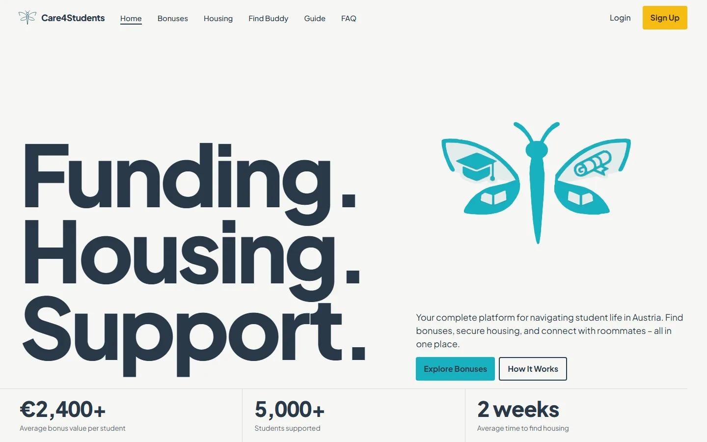
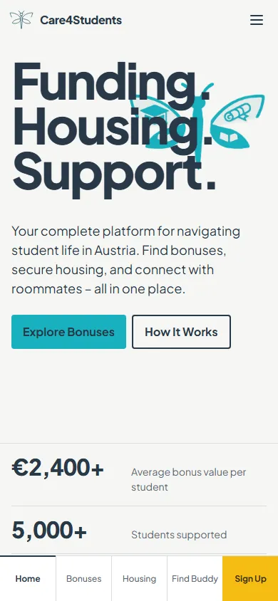
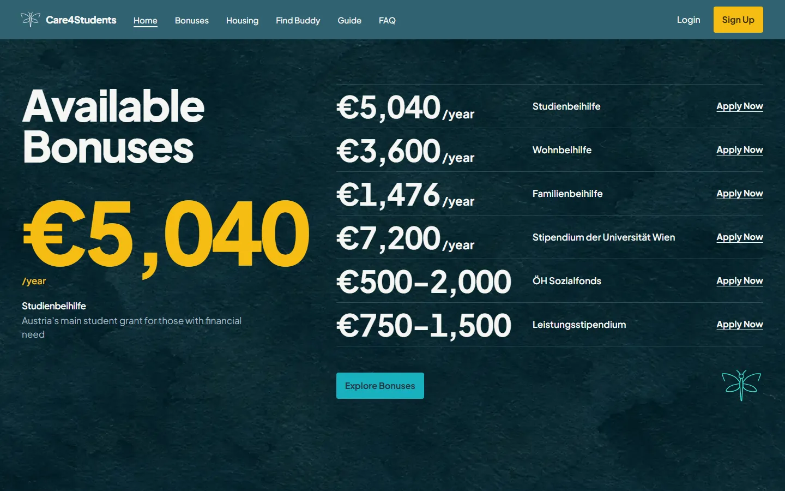
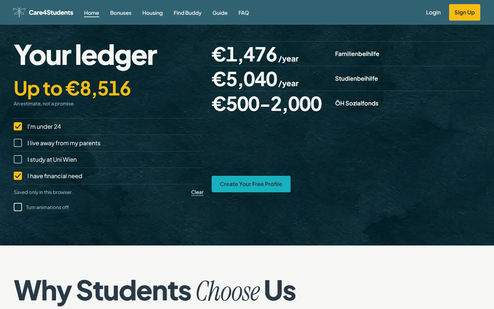
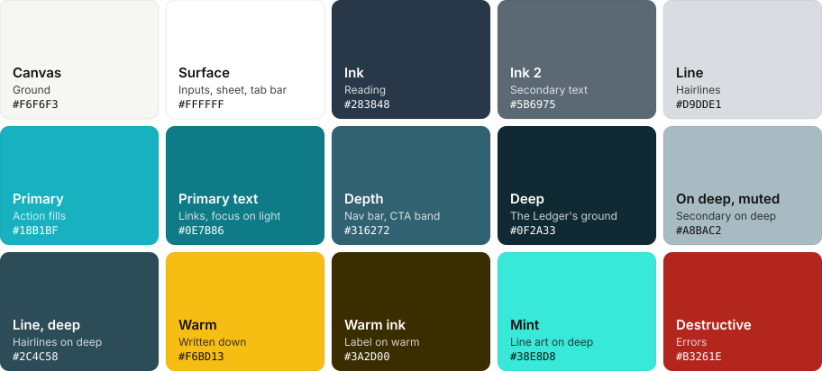
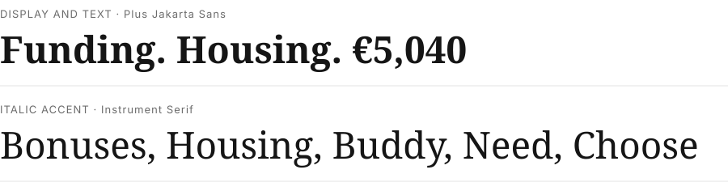

<p align="center">
  
</p>

<h1 align="center">Care4Students</h1>

<p align="center">Funding, housing and roommate support for university students in Austria: bonuses, a housing guide, a buddy finder, FAQ and contact.</p>

<p align="center">
  <a href="https://care4students.netlify.app/"></a>
  
  
</p>

---

## Screens

The Bright Ledger redesign on branch `redesign-2026`. The live site shows the previous design until this branch is deployed.

<table>
  <tr>
    <td width="74%"></td>
    <td width="26%"></td>
  </tr>
</table>

<table>
  <tr>
    <td></td>
    <td></td>
  </tr>
</table>

## Brand

**Palette**



**Typography**



| Role | Typeface | Use |
|---|---|---|
| Display and text | Plus Jakarta Sans 400–800 | All headlines, body, interface and tabular figures |
| Accent | Instrument Serif italic | Five ruled heading words and the pull quotes, never a figure |

**Marks.** The dragonfly, as code-drawn line art (`src/components/brand/DragonflyMark.tsx`) and as a die-cut paper object rendered in Blender for the hero (`public/media/dragonfly/`). The artwork's origin and rights are still an open question.

**Voice.** Warm, practical, plain-spoken and concrete. English, with German terms used as they are (WG, Studienbeihilfe).

**Rules.** Everything hangs off a hairline. Amounts lead rows. Warm means "this is written down". The deep ground appears once, on home.

The full design system is in [`DESIGN.md`](DESIGN.md), with machine-readable tokens in [`design.json`](design.json) and the product brief in [`PRODUCT.md`](PRODUCT.md).

## Stack

| Layer | Choice |
|---|---|
| App | React 18, TypeScript, Vite 5, react-router 6, every page lazy-loaded |
| UI | Tailwind 3, shadcn/ui (Radix) |
| Motion | GSAP + ScrollTrigger and Lenis, in one chunk loaded only on `/` at desktop size with a fine pointer. Phones run CSS and IntersectionObserver |
| Fonts | Self-hosted from `@fontsource`, three preloads |
| Auth | Client-side mock in `localStorage`. There is no backend |
| Personal ledger | `localStorage` only. Nothing a visitor ticks leaves the browser |
| Tests | Playwright scripts in `qa/` |

## Run locally

```bash
npm ci
```

```bash
npm run dev
```

The dev server is on http://localhost:8080. `npm run build` writes to `dist/`, and `npm run preview` serves it.

| Check | Command | Expects |
|---|---|---|
| Lint | `npm run lint` | The known 2 errors and 8 warnings, the errors in stock shadcn files, so it exits non-zero |
| Phone budgets | `npm run qa:mobile` | 12 routes at 5 widths. Needs `npx playwright install chromium` once |
| Copy | `npm run qa:copy` | No string lost against `origin/main` |

## Deploy

Netlify builds from this repo with `npm run build` and publishes `dist/`. `public/_redirects` serves `index.html` for every path, so direct links work; this has been checked under `vite preview`, not yet on Netlify.

The repo still carries a stale `bun.lockb`. Netlify's docs say that lockfile makes it run `bun install` instead of `npm install`, so read [the handoff](.olympus/09-handoff.md#push-and-deploy) before deploying.

## Structure

```
src/pages/             routes; Dashboard* are mock pages kept from before
src/components/home/   home sections; HomeMotion.tsx is the only GSAP chunk
src/components/page/   shared parts of the other routes
src/components/ledger/ personal ledger controls, signup progress
src/components/brand/  DragonflyMark, the vector mark
src/data/bonuses.ts    the six bonuses, shared by home and /bonuses
src/lib/               ledger storage, storage guard, Lenis setup
src/mobile.css         phone shell and tab bar
public/media/          dragonfly frames, phone poster, Ledger plates
public/fonts/          self-hosted woff2
qa/                    phone budgets and copy check
docs/                  README screenshots and brand assets
.olympus/              design run: evidence, plan, QA, review, handoff
```

## Status

Independent review: **pass with notes, 87/100**, no open defects. Awaiting owner review on `redesign-2026`; not pushed or deployed.

- **Not verified:** real devices, Safari and WebKit, safe-area insets, screen readers, Netlify itself, and field performance. Everything was tested in headless Chromium.
- **Figures not verified:** copy is carried over unchanged. The headline statistics have no source, €5,040/year is out of date against the 2026/27 ordinance, and this design makes all of them larger. The personal ledger's "Up to €N" is a new sum built on them. These are the owner's first decision.
- **Before a real launch:** Imprint values are placeholders, and sign-up and contact are mocks.

Details, the before-and-after numbers, asset provenance and the push commands are in [`.olympus/09-handoff.md`](.olympus/09-handoff.md).

---

<sub>Designed and built by Convenium Studio, Klagenfurt. Brand assets regenerate with `templates/readme/make_readme_assets.py` from `docs/brand/brand.json`; the serif specimen uses the site's own italic file, which that script skips by default.</sub>
